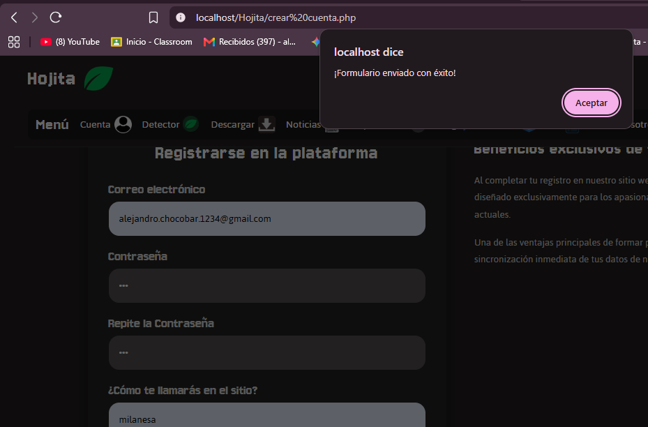

Hojita - Plataforma de Música Digital (Clase 5: Formularios y Seguridad Web)

1. Enlace al Prototipo de Figma
Podés consultar el diseño y prototipado inicial del proyecto en el siguiente enlace:
* 'https://www.figma.com/design/B0rzDYVbuGJT0nObl8nOs5/Mockups-Figma?node-id=0-1&p=f&t=Ae1cLPn8BnH0kBBd-0'

2. Procesamiento Dinámico de Formularios y Seguridad Web (Clase 5)

En esta etapa se incorporó la lógica del lado del servidor para capturar y procesar datos enviados desde el navegador, aplicando normativas de seguridad estrictas (OWASP Top 10 - XSS).

 A. Implementación de Formularios (POST y GET)
* Envío por POST: Utilizado en formularios de registro, contacto y opiniones:
  * `crear-cuenta.php`: Registro de usuarios validando campos obligatorios, formato de correo electrónico y coincidencia de contraseñas.
  * `CV.php`: Formulario de postulación laboral con múltiples campos de texto y datos de contacto.
  * `blog.php`: Módulo interactivo para el envío y publicación de comentarios de la comunidad.
* Envío por GET: Utilizado en módulos de búsqueda y consultas rápidas:
  * Implementado en los buscadores internos de `ayuda.php`, `descargar_musica.php`, `noticias.php`, `reproductor.php`, `seccion_albumes.php`, `seccion_explorar.php` y en el buscador global del `header.php`.

 B. Sanitización Estricta y Seguridad (Mitigación de XSS)
* Sanitización de Entradas: Ninguna variable recibida mediante `$_POST` o `$_GET` se muestra ni procesa sin ser saneada previamente. Se emplearon funciones nativas de PHP como:
  * `trim()` para eliminar espacios innecesarios.
  * `htmlspecialchars(..., ENT_QUOTES, 'UTF-8')` para convertir caracteres especiales y prevenir la ejecución de scripts maliciosos (Cross-Site Scripting).
  * `filter_var(..., FILTER_VALIDATE_EMAIL)` para asegurar la validez estricta de las direcciones de correo.
  * Validación en Servidor: Uso estricto de estructuras de control con `empty()` e `isset()` para verificar que los campos requeridos no lleguen vacíos.

 C. Retroalimentación en la Interfaz y Persistencia de Datos
* Mensajes al Usuario: Se programaron alertas visuales dinámicas que informan de manera clara al usuario si el envío fue exitoso o si se produjeron errores de validación.
* Persistencia: Gracias a la renderización controlada mediante atributos `value="..."` en los inputs y condiciones lógicas en los elementos de selección (`checked`), los datos ingresados por el usuario no se pierden si ocurre un error de validación, evitando que deban reescribirlos.

3. Evidencias de Funcionamiento (Capturas de Pantalla)

 * a. Procesamiento y validación del formulario de Registro (POST):

* b. Búsqueda dinámica con persistencia de datos y mensaje en pantalla (GET):*

